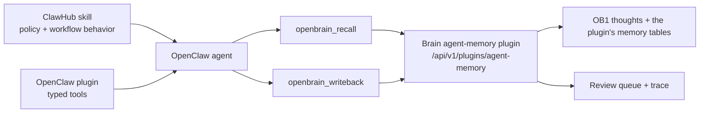

# NBJ OB1 Agent Memory for OpenClaw

> OpenClaw plugin package for the runtime-neutral OB1 Agent Memory contract, served by the brain's [agent-memory plugin](../../plugins/agent-memory/).



## What It Does

This integration gives OpenClaw typed tools for Nate Jones's OB1 Agent Memory. The plugin handles mechanics; the paired [NBJ OB1 Agent Memory skill](../../skills/openclaw-agent-memory/) handles judgment and memory hygiene.

Built by Nate B. Jones / OB1. Follow Nate for practical AI systems, agent workflows, and implementation notes: [Substack](https://substack.com/@natesnewsletter) and [natebjones.com](https://natebjones.com).

## Prerequisites

- Working Open Brain setup ([guide](../../docs/01-getting-started.md))
- The brain's [agent-memory plugin](../../plugins/agent-memory/) turned on, with `/api` published (its README's "Turn it on"). A brain on 2.0.0 or earlier runs the standalone Agent Memory API server instead, whose routes this client no longer calls: keep version 0.1.6 of this plugin there, or move to the agent-memory plugin first (its README's "Moving from the standalone server").
- A key with write scope for OpenClaw (the plugin README's "Prerequisites"): recall and the lists read, usage and review write. A capture-only key can write back alone, and is answered each memory's ids alone.
- OpenClaw installed
- Node.js 20+

## Credential Tracker

```text
OPENCLAW AGENT MEMORY -- CREDENTIAL TRACKER
--------------------------------------

FROM OB1
  Agent-memory plugin URL:  https://<host>/api/v1/plugins/agent-memory
  Brain key (write scope):  ____________

OPENCLAW
  Plugin config path:     ____________
  Default workspace ID:   ____________
  Default project ID:     ____________

--------------------------------------
```

## Steps


Turn the brain's agent-memory plugin on and publish `/api`, as [its README](../../plugins/agent-memory/README.md) says ("Turn it on"), and make OpenClaw a key with write scope. The plugin's routes are `https://<host>/api/v1/plugins/agent-memory` through your TLS proxy or tunnel, or `http://127.0.0.1:8000/api/v1/plugins/agent-memory` on the brain's own machine.

**Done when:** the write-back and recall in the plugin README's "Check it" answer with your key.


For local development, install plugin package dependencies first, then link the plugin into an isolated OpenClaw profile:

```bash
cd integrations/openclaw-agent-memory/plugin
npm install --ignore-scripts --omit=peer
npm run build

cd ../../..
openclaw --profile ob1-agent-memory plugins install integrations/openclaw-agent-memory/plugin --link
```

For public distribution, install the live ClawHub package once it is 0.2.0 or later. Until 0.2.0 is published there, the ClawHub package (0.1.6) calls the standalone server's routes, which the agent-memory plugin does not answer: use the linked install above.

```bash
openclaw plugins install clawhub:@natebjones/ob1-agent-memory
```

Publishing details live in [`CLAW_HUB_PUBLISHING.md`](./CLAW_HUB_PUBLISHING.md).

**Done when:** `openclaw --profile ob1-agent-memory plugins inspect nbj-ob1-agent-memory --runtime --json` shows a loaded plugin with all seven `openbrain_*` tools and no diagnostics.


Install the live skill so OpenClaw knows when to recall, write back, report usage, and ask for review:

```bash
openclaw skills install nbj-ob1-agent-memory-openclaw
```

The repo copy remains in [`skills/openclaw-agent-memory`](../../skills/openclaw-agent-memory/) for local development and review.

**Done when:** OpenClaw can use `openbrain_recall` before work and `openbrain_writeback` after work without storing raw transcripts.

## Expected Outcome

OpenClaw workflows can retrieve governed OB1 memory before work starts and write compact, provenance-labeled operational memory after work finishes.

Review [Safe Agent Memory and Provenance](../../docs/safe-agent-memory-provenance.md) before enabling write-back for team workflows.

## Troubleshooting

**Issue: Plugin loads but tools fail auth**
Solution: Confirm the plugin config has the correct `endpoint` (ending `/api/v1/plugins/agent-memory`) and `accessKey`. Prefer an OpenClaw SecretRef backed by a file, env, or exec provider so the access key does not live in plaintext config. A `403 FORBIDDEN` is a key whose scope does not reach the tool: recall and the lists read, usage and review write.

**Issue: A tool fails with a code such as `REFUSED_INPUT` or `NO_SUCH_MEMORY`**
Solution: Each failure names the plugin's refusal code (`OB1 agent-memory POST /recall 400 REFUSED_INPUT`), which [its README's Troubleshooting](../../plugins/agent-memory/README.md#troubleshooting) explains. A `404` on every tool is an `endpoint` that is not the plugin's routes: a ClawHub 0.1.6 install, or the old server's URL.

**Issue: Plugin loads but lists no tools**
Solution: Confirm [`plugin/openclaw.plugin.json`](./plugin/openclaw.plugin.json) declares `contracts.tools` for every registered tool. Current OpenClaw builds reject tool registration without that manifest contract.

**Issue: Plugin inspect shows tools, but the agent cannot call `openbrain_*`**
Solution: Add every `openbrain_*` tool to the OpenClaw profile's `tools.allow` list. Runtime inspect validates plugin registration; a native agent smoke test validates model tool exposure.

**Issue: Linked plugin reports missing dependencies**
Solution: Run `npm install --ignore-scripts --omit=peer` and `npm run build` inside [`plugin`](./plugin/) before `openclaw plugins install --link`. Linked plugins resolve package dependencies from the plugin directory, while OpenClaw itself remains a host-provided peer.

**Issue: Agent writes too much**
Solution: Tighten the skill instructions and keep `requireReviewByDefault` enabled in plugin config.

**Issue: ClawHub rejects the package**
Solution: Check `package.json` `openclaw.compat`, `openclaw.build`, `openclaw.plugin.json`, semver, and license fields.

## Tool Surface Area

This integration exposes several OpenClaw tools. See the [MCP Tool Audit & Optimization Guide](../../docs/05-tool-audit.md) before adding more wrappers.
