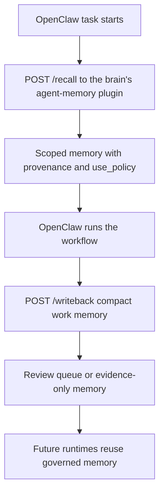

# NBJ OB1 Agent Memory for OpenClaw



This recipe makes OB1 the continuity layer for OpenClaw workflows. OpenClaw performs the work; OB1 stores the durable operational memory that future agents can inspect, trust, reject, or reuse.

Built by Nate B. Jones / OB1. Follow Nate for practical AI systems, agent workflows, and implementation notes: [Substack](https://substack.com/@natesnewsletter) and [natebjones.com](https://natebjones.com).

## Quick Path

1. Turn the brain's [agent-memory plugin](../../plugins/agent-memory/) on and publish `/api`, as its README says ("Turn it on"). Its routes, under `https://<host>/api/v1/plugins/agent-memory`, are the contract below: `POST /recall`, `POST /writeback`, `POST /recalls/{request_id}/usage`, and the review routes. A brain on 2.0.0 or earlier runs the standalone Agent Memory API server instead; move to the plugin first (its README's "Moving from the standalone server").
2. Install the OpenClaw plugin, version 0.2.0 or later, which calls the agent-memory plugin's routes. Until 0.2.0 is on ClawHub, link it from this repo ([the plugin README](../../integrations/openclaw-agent-memory/plugin/)); once it is:

   ```bash
   openclaw plugins install clawhub:@natebjones/ob1-agent-memory
   ```

3. Install the live OpenClaw skill:

   ```bash
   openclaw skills install nbj-ob1-agent-memory-openclaw
   ```

4. Read [Safe Agent Memory and Provenance](../../docs/safe-agent-memory-provenance.md).
5. Start with [Code Review Memory](../openclaw-code-review-memory/) or [TaskFlow Work Log](../openclaw-taskflow-work-log/).

Local development path: use [the plugin README](../../integrations/openclaw-agent-memory/plugin/) if you need to link the plugin from this repo instead of installing the ClawHub package.

## Contract Files

| Contract | Purpose |
| -------- | ------- |
| [recall.schema.json](contracts/recall.schema.json) | Pre-task recall request |
| [recall-response.schema.json](contracts/recall-response.schema.json) | Policy-labeled recall response; `request_id` is `null` when the key was read-scoped and no trace was stored (Daemonic Brain, SMD-1455); each memory carries its type, thought, review and lifecycle status (the agent-memory plugin, SMD-2690) |
| [writeback.schema.json](contracts/writeback.schema.json) | Post-task memory write-back |

## Example Payloads

| Example | Purpose |
| ------- | ------- |
| [recall-request.json](examples/recall-request.json) | Minimal OpenClaw pre-task recall |
| [writeback-request.json](examples/writeback-request.json) | Compact post-task write-back |
| [usage-report.json](examples/usage-report.json) | Recall trace usage report, sent to `POST /recalls/{request_id}/usage` |

## Defaults

- Agent-written memory starts as evidence, not instruction.
- Instruction-grade memory requires human confirmation or trusted import.
- Write-back requires idempotency and content-hash dedupe.
- Raw transcripts, model reasoning traces, secrets, large code blocks, and private customer dumps are blocked or flagged.
- Project scope is the default when available.
- Personal or channel memory never auto-promotes to team or workspace scope.

The full safety model lives in [Safe Agent Memory and Provenance](../../docs/safe-agent-memory-provenance.md).

## What To Recall

Recall should be narrow and useful:

- decisions
- constraints
- lessons
- prior attempts
- owners
- source-backed facts
- relevant artifacts

Do not inject every semantically related thought. The response includes `use_policy`; OpenClaw agents must respect it.

## What To Write Back

Write back compact operational memory:

- decisions
- outputs
- lessons
- constraints
- unresolved questions
- next steps
- failures
- artifact references

Do not store transcripts or scratchpads by default. Store source references instead.

## Visual Assets

Use [the Agent Memory visual asset pack](../../docs/assets/agent-memory/) for Linear issue docs, repo docs, and tutorial material.

## Portability

V1 uses Postgres because the brain runs there now, but the API contract is designed to avoid storage lock-in. SQLite/local support is not part of the launch scope; it is a future migration-assistant path documented in [OB1 Agent Memory Storage Portability](../../docs/agent-memory-portability.md).
